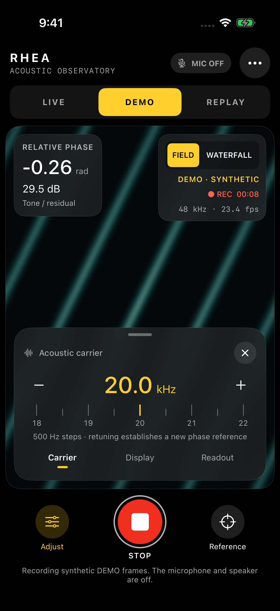
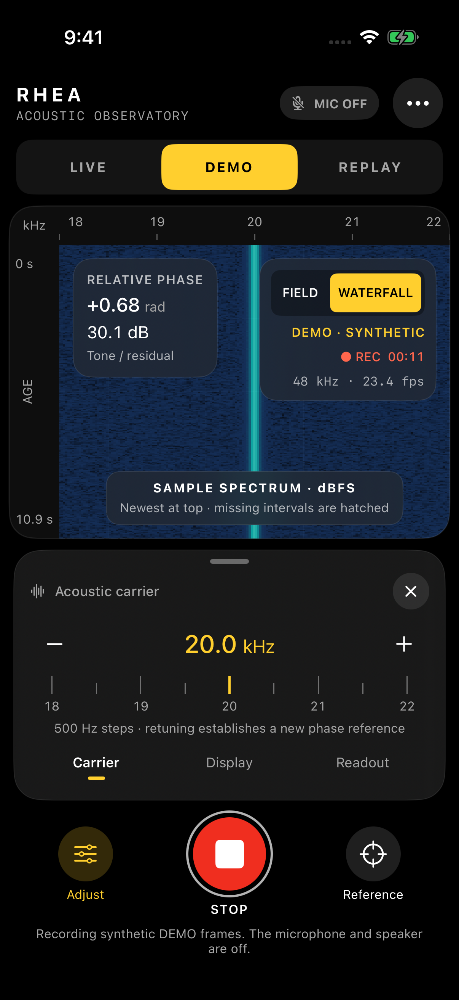

# Rhea RF Spanner

An inspectable iOS application for **passive audio analysis and acoustic phase
experiments** using an iPhone's built-in microphone and, for an explicitly
selected tone experiment, its speaker. The display name is **Rhea RF Spanner**;
the public source repository is
[timelabs-npo/Rhea-RF-Spanner](https://github.com/timelabs-npo/Rhea-RF-Spanner).

The Observatory update adds an **18–22 kHz acoustic carrier grid in 500 Hz steps**,
silent deterministic **DEMO**, in-memory **REPLAY**, and an actual sample-spectrum
**Waterfall**. The G1 source change adds **LIVE · LISTEN**: input-only analysis
with no generated tone, alongside the existing active Tone experiment. LIVE
requires an actual 48 kHz built-in input; the passive branch does not require an
output route. The app does not
access RF samples, cellular baseband hardware, or wireless packet traffic.
Field graphics are explicitly abstract (LIVE) or synthetic (DEMO). They do not
represent a measured spatial radar image. A phase-derived displacement is a
conditional model, not an absolute range measurement.

The native interface uses a full-screen Metal viewport, dark material panels,
system menus, a carrier ruler, and separate acquisition/display controls. Its
reference is the legibility and control hierarchy of professional camera apps.
False color does not imply thermal sensing.

## Build and validation status

**Current source candidate: 0.2.2 (4), useful passive audio.** LIVE opens in
Listen, with measured levels and spectrum independently of the active tone
experiment. The implementation and focused digital fixtures are ready for
native review; exact-candidate Mac CI and TestFlight delivery are pending.
See [the passive-audio behavior](docs/PASSIVE_AUDIO.md) and
[its evidence record](docs/PASSIVE_AUDIO_VALIDATION.md).

The owner installed **0.2.0 (2)** and reported that it did not yet provide useful
behavior. No physical-device diagnostic report is available, so the underlying
hardware/runtime cause remains unconfirmed. The G0 diagnostic foundation adds
observed input/DSP/GPU counters, retained error and stop evidence, a protected
Copy Diagnostic Dump action, an analytical self-test, and full-band Waterfall.

| Version / scope | Observed evidence |
| --- | --- |
| 0.2.0 (2), previous release | Apple processing VALID, internal testing enabled, owner-confirmed installation and initial test; useful physical operation remains unverified |
| 0.2.1 (3), diagnostic foundation | Source `722ee840` passed 63 core + 16 hosted tests, both iOS builds and four native captures in [run 42436184984](https://github.com/timelabs-npo/Rhea-RF-Spanner/actions/runs/42436184984). Subsequent watchdog/copy corrections at `d4903b84` are undergoing [exact-source validation](https://github.com/timelabs-npo/Rhea-RF-Spanner/actions/runs/42438050312); delivery pending |
| 0.2.2 (4), this passive-audio candidate | Separate WD Codex implementation and review, integration corrections and new digital/hosted fixtures; native execution and delivery pending |

The [G0 evidence record](docs/DIAGNOSTIC_RELEASE_VALIDATION.md) preserves exact
sources, test counts, review findings and artifact identities. WD sessions have
not compiled Swift: native builds execute on Mac CI. Digital fixtures and
Simulator screenshots do not establish physical microphone performance or
calibration.

The staged [project roadmap](docs/project/ROADMAP.md),
[resumable checkpoint](docs/project/NEXT_SESSION.md), and
[tracking issue](https://github.com/timelabs-npo/Rhea-RF-Spanner/issues/2) distinguish
implemented audio features from planned AR/LiDAR, external probes and shared
sessions. A verified software candidate and field confirmation are separate gates.

Earlier release evidence remains in the
[Observatory report](docs/OBSERVATORY_VALIDATION.md),
[TestFlight preparation report](docs/TESTFLIGHT_PREPARATION_VALIDATION.md),
[signed export record](docs/SIGNED_EXPORT_VALIDATION.md), and
[Apple upload/processing record](docs/TESTFLIGHT_UPLOAD_VALIDATION.md).
The images below are the retained **previous-release DEMO captures**, not a
physical microphone or spatial RF measurement.

| Silent DEMO Field | Sample-spectrum Waterfall |
| --- | --- |
|  |  |

See [docs/BUILD_STATUS.md](docs/BUILD_STATUS.md) for historical baseline results
and the distinction between portable-core, iOS, signing, and physical-device
results. Compiler logs are retained under `docs/validation/`.
A passing `swift build` builds the reusable core; it does not create an iOS app
or an installable TestFlight build.

## Open in Xcode

Open **`RheaRFSpanner.xcodeproj`** and select the shared **RheaRFSpanner** scheme.
The project links the local `RheaRFCore` Swift package. There are no external
runtime dependencies and no XcodeGen, CocoaPods, Carthage, or Ruby prerequisites.
The Xcode project and app icon are committed, so project generation is optional.

The deployment target is **iOS 18.0** and the language mode is **Swift 6**.
For App Store Connect uploads, use **Xcode 26 or later with the iOS 26 SDK or
later**, as required by Apple since April 28, 2026. Deployment and build-SDK
versions serve different purposes. See [Apple's requirement](https://developer.apple.com/news/upcoming-requirements/?id=04282026a).

On an authorized build Mac:

```bash
bash scripts/build.sh all
```

This runs the Swift core tests and compiles both the simulator application and
the unsigned device application. Logs go to `build/logs/`. The simulator can
run the silent DEMO and Replay; LIVE acoustic capture requires a physical iPhone.
`python3 scripts/capture_simulator.py` captures the actual native idle, DEMO,
Waterfall, and Diagnostics screens after the simulator build. CI retains these
as artifacts.

For portable core work on Swift 6-capable macOS or Linux:

```bash
swift build -c release
swift test
swift test -c release
```

These are instructions for the worker carrying out the build; the phone owner
does not need a local laptop or to copy source code from chat.

## Using the app

1. Read **Privacy & method** while idle. **LIVE · LISTEN** is the ordinary audio
   entry point. Tap **Start listening** to request microphone permission if needed.
   A first permission grant returns to idle; start again deliberately.
2. Listen analyzes the built-in microphone without constructing a tone source.
   Inspect RMS in dBFS, peak amplitude in full-scale units, and **Full audio ·
   0–24 kHz** Waterfall. These are digital levels, not calibrated sound pressure.
   Other playback on this phone may
   be suppressed while its recording-only session is active.
3. For active phase work, explicitly choose **Tone experiment**, agree to its
   speaker output, then start. Its 18–22 kHz carrier grid and phase/reference
   behavior remain available. Selecting Listen or Tone ends the current run and
   requires another Start; the selection itself never restarts acquisition.
4. Gain, palette, persistence, and spectrum range affect only presentation. The
   Listen narrow range is labelled **18–22 kHz**; it does not create a carrier.
   Listen has no tone-fit, phase, displacement, or reference-reset controls.
5. Stop at any time. The bounded passive Waterfall remains labelled as stopped
   history; a new Listen run starts new history and a new capture clock. **REPLAY**
   contains only active Tone/DEMO records with their original LIVE/DEMO labels.
   Passive Replay is deferred; passive frames are never appended to the v1 tape.
   **DEMO** remains a silent deterministic simulation, never live microphone data.
6. Open **Diagnostics** to inspect observed callbacks, input RMS/peak, processed
   frames, GPU completions, and retained operational events. Run the silent core
   self-test to check an analytical fixture without starting audio. **Inspect
   JSON report** previews the aggregate report; **Copy Diagnostic Dump** copies
   it locally only when you explicitly request it.

The ordinary launch uses Listen and **Full audio · 0–24 kHz Waterfall** so incoming
sound can be inspected without an ultrasonic carrier fit or generated tone.
**MIC SESSION** means that the
audio session is active; the separate observed-input status confirms whether
accepted callbacks are arriving. A LIVE input or processing stall stops the
session with a retained reason rather than silently remaining active.

The app stops when it loses foreground activity, audio is interrupted, the route
changes, or audio services reset. It never automatically restarts after these
events. An explicit carrier change during a running Tone experiment performs a controlled
restart with a new reference. It accepts
the built-in microphone at the checked 48 kHz format; Tone also requires the
built-in speaker. It reports
unsupported hardware routes instead of trapping on a failed precondition.

In Tone experiment, the fixed transmit amplitude is 0.02 of digital full scale,
with a 10 ms ramp.
This is not a sound-pressure calibration or a claim that the tone is inaudible.
Keep the phone away from ears, use the experiment with nearby people's agreement,
and stop if it is uncomfortable. Start with low device volume.

## Data handling

Microphone samples are processed in volatile memory. Listen retains only its
bounded live display history; it does not write Replay records. Up to 2,048
derived active Tone/DEMO telemetry slices and their bounded companion spectra
are retained in memory for Replay; raw audio is not recorded. Closing the
process loses the tape and display history. There is
no raw-audio or Replay export UI, account, server, telemetry SDK, advertising,
remote configuration, background audio mode, or downloaded code. Diagnostics
can be previewed as JSON and copied explicitly. The report contains aggregate
statistics and bounded operational events, not audio samples, spectrum arrays,
images, route identifiers, or absolute boot/host timestamps. The device-local
clipboard copy expires after one hour and may outlive the app process. It is
not transferred through Handoff; a copy pasted elsewhere has its own lifetime.
The privacy text is available in the app without microphone permission. The
source privacy policy is [docs/PrivacyPolicy.md](docs/PrivacyPolicy.md).

Developer mailboxes, certificate keys, provisioning profiles, and API credentials
are operational material. They are not bundled with this application or included
in this source repository.

## Repository map

| Path | Purpose |
| --- | --- |
| `RheaRFSpanner.xcodeproj/` | Installable iOS application target and shared scheme |
| `App/Sources/` | SwiftUI interface, audio lifecycle, serial DSP integration, Metal display |
| `App/Resources/` | Info.plist, privacy manifest, app icon |
| `Package.swift` | Swift 6 package manifest for the reusable signal core |
| `Sources/RheaRFCore/` | Z96 reference, SPSC queue, phase fit, FFT, deterministic simulator, 64-byte codec, Replay tape |
| `Tests/RheaRFCoreTests/` | Numerical, transport, spectrum, simulation, codec, Replay, and concurrency tests |
| `AppTests/` | Simulator-hosted lifecycle, renderer, diagnostics, report, and self-test checks |
| `Config/` | Build settings and signing override example |
| `scripts/` | Reproducible project generation, builds, archive/export, publication guard |
| `docs/` | Signal model, architecture, review letter, review steps, privacy, validation |

## Read before making measurement claims

[SIGNAL_MODEL.md](docs/SIGNAL_MODEL.md) states the estimator equations and
physical assumptions. [PORTING_AUDIT.md](docs/PORTING_AUDIT.md) distinguishes
repairs to the supplied pasted script from intentional algorithm and lifecycle
changes. The new estimator uses portable Double operations and a weighted
least-squares tone model. It is not advertised as the original vDSP algorithm,
as a zero-jitter implementation, or as a calibrated ranging instrument.
[OBSERVATORY.md](docs/OBSERVATORY.md) defines the new modes, display semantics,
frequency transitions, and explicit 64-byte encoding.

## TestFlight and App Store preparation

The third-party build Mac needs an authorized Apple Developer team, a registered
bundle identifier, and valid signing assets. `org.timelabs.RheaRFSpanner` is now
registered for **TAIMLABS, OOO**, team **398XACWZ7G**, and was checked against its
Apple-issued provisioning profile during the successful signed export.
The signing override is `Config/Signing.local.xcconfig`, which is excluded from
Git. `bash scripts/archive.sh` creates the signed archive only after the actual
signing configuration is present. `scripts/export.sh` accepts team-specific
export options; it does not invent an Apple team or upload an app automatically.

The manually dispatched **TestFlight** workflow also supports a GitHub-hosted
Mac, an exact reviewed source SHA, and existing signing assets supplied through
the protected `testflight` environment. Its default is a signed archive and local
IPA export. Apple validation/upload requires an explicit input. The included
Windows intake form sends selected local credentials directly to encrypted
GitHub environment secrets; it never starts a build or upload.
See [the TestFlight operator guide](docs/TestFlight.md) and
[Windows signing preparation](docs/WindowsSigning.md). The latter creates a
local CSR, completes an Apple-issued certificate with its existing Windows key,
and stores an encrypted recovery copy without printing private key material or
passwords. Signed export and Apple validation/upload have completed for
**0.2.0 (2)**. Apple processing and tester availability remain separate stages;
processing is confirmed, the internal group contains the **Ready to Test** build,
and the owner reports successful installation. This confirms delivery, not
physical measurement accuracy or a resolution of the reported LIVE problem.
See the [upload validation record](docs/TESTFLIGHT_UPLOAD_VALIDATION.md).

See [AppleSubmission.md](docs/AppleSubmission.md),
[AppReviewLetter.md](docs/AppReviewLetter.md), and
[ReviewTestPlan.md](docs/ReviewTestPlan.md). Match every submission statement to
the final binary and source commit, and complete physical-device checks before
submitting it. The choice of a source license remains separate from publication;
no license grant is asserted here.

