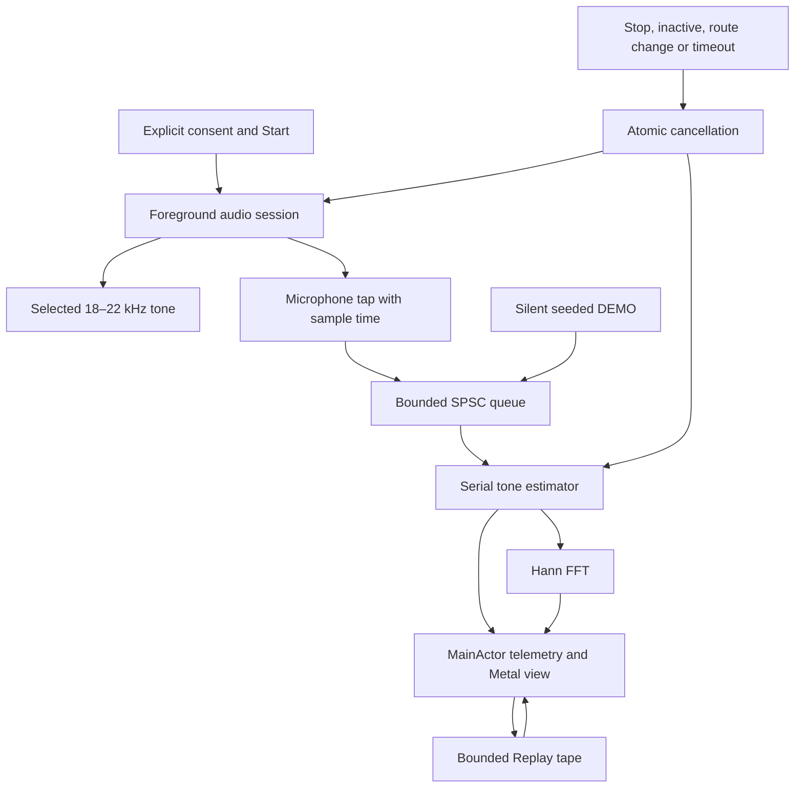

# Architecture and ownership

The installable application is an Xcode app target. `RheaRFCore` is a local Swift
package with no Apple-only imports; it can be compiled and tested independently.
All application frameworks are public Apple APIs.

## Signal path

The tone travels through the built-in audio route. The graph describes software
ownership, not a proof that the received phasor corresponds to one reflected
target. Direct coupling and multipath are discussed in `SIGNAL_MODEL.md`.

## Concurrency contract

| Component | Owner | Shared state |
| --- | --- | --- |
| SwiftUI model and AVAudioEngine lifecycle | Main actor | Immutable run identity; atomic control object |
| Tone oscillator and output timeline | Serial source-node render callback | Cancellation and rendered-sample counters only |
| Capture timestamp normalization | Serial input tap | One producer of the ring |
| Signal estimator and calibration state | One dedicated serial DSP queue per run | One consumer of the ring |
| Synthetic sample generation | Same serial DEMO queue as its DSP consumer | Separate from audio and display settings |
| Telemetry | Immutable `Sendable` value | Recorded in per-worker FIFO order; visible live data must match the active run |
| Replay tape | Main actor | 2,048 encoded records plus bounded spectrum companions |
| Metal view and uniforms | Main actor | Data-driven field/history; no audio pointers |

The `@unchecked Sendable` types each document their ownership assumptions. They
are not assertions that arbitrary concurrent calls are safe. The audio callback
and estimator do not call each other's mutable methods. UI reference-reset
requests cross the boundary through an atomic flag consumed by the DSP owner.

Every experiment creates fresh oscillator, ring, and estimator objects. There is
no public ring reset function and no zeroing of storage while a callback might
be using it. Callback contexts retain the objects they use. A retiring DSP worker
can exit after a new session starts without sharing its storage or publishing
stale live telemetry into the new run. Retuning waits asynchronously for the
retiring worker to post its final frames and completion before starting the
replacement worker. Replay/scrubbing remain disabled while that retirement is
in progress; its selection is reconciled once the bounded tape is stable.

## Validity

The capture time is carried with every sample. Overflow rejects an entire input
block and increments block/sample counters; the next accepted block retains the
real capture gap. Missing timestamps, internal discontinuities, nonfinite values,
low carrier amplitude, and poor model fit invalidate the phase. Empty consumer
polls are ordinary scheduling events and are not reported as dropped readings.

The first valid frame after start, loss, or reset becomes a new zero reference.
The app displays this rebaselining. It does not integrate phase across unknown
history. The received tone fit does not establish an independently calibrated
transmit/receive phase reference or prove target motion.

## Audio lifecycle

Launch remains idle. Microphone permission is requested only after the explicit
Start action. The first permission grant returns to idle. A second deliberate
Start begins the experiment; permission UI or returning from Settings cannot
start the tone automatically.

The app does not request background audio. Resigning active, route changes,
interruptions, configuration changes, audio-service loss/reset, errors, and the
session limit end the current run. Audio notification callbacks request atomic
cancellation; AVAudioEngine is stopped and released by its main-actor owner,
outside the engine's own configuration notification callback. Explicit carrier
changes create a new run/reference while preserving the recording's 60-second
budget. DEMO never constructs an audio transceiver; Replay never starts one.

## Rendering and privacy manifest

`PhaseShaders.metal` is a real Xcode-compiled shader source, loaded from the
default Metal library. It renders abstract/synthetic phase graphics and an actual
sample-spectrum waterfall. Image changes follow new records or display controls,
not an independent clock presented as measurement. GPU uniform data uses float4
groups with matching MSL alignment; it is distinct from the 64-byte wire record.

`PrivacyInfo.xcprivacy` is a valid XML property list with tracking false and empty
tracking-domain and collected-data arrays. The Observatory session timer and
DEMO pacing use `ProcessInfo.systemUptime` solely for elapsed-time calculations;
the manifest declares `NSPrivacyAccessedAPICategorySystemBootTime` with reason
`35F9.1`. No boot timestamp is recorded or transmitted. See Apple's
[approved reason](https://developer.apple.com/documentation/bundleresources/app-privacy-configuration/nsprivacyaccessedapitypes/nsprivacyaccessedapitype).
Reaudit the manifest whenever APIs or third-party code are added. The separate
microphone purpose string belongs in Info.plist; it is not replaced by the
privacy manifest.

## What the build evidence can establish

Portable tests exercise numerical and queue behavior with generated input.
An unsigned Xcode device build establishes compilation/linking against an iOS
SDK. Neither proves correct speaker response, microphone response, acoustic
safety at every volume, microphone/speaker clock behavior, or useful target
sensitivity. Device observations, signing, upload, and App Review remain
separate evidence recorded in the release documentation.
