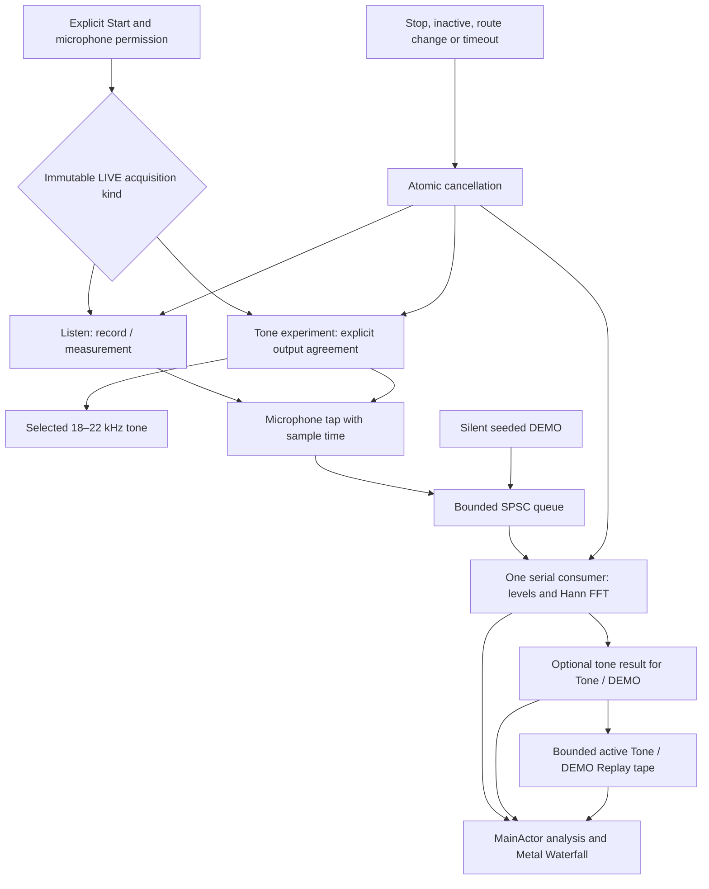

# Architecture and ownership

The installable application is an Xcode app target. `RheaRFCore` is a local Swift
package with no Apple-only imports; it can be compiled and tested independently.
All application frameworks are public Apple APIs.

## Signal path

Listen constructs no tone context, oscillator, source node, speaker override, or
microphone-to-output connection. It checks enabled built-in input and actual
session/input rates of 48 kHz, with noninterleaved Float32 input; it does not
require output availability or validate an output format. Tone experiment retains
its built-in speaker/input contract. A preferred rate is a request, not the
observed rate. See [PASSIVE_AUDIO.md](PASSIVE_AUDIO.md) for the bounded G1 contract
and required validation.

An active tone travels through the built-in audio route. The graph describes software
ownership, not a proof that the received phasor corresponds to one reflected
target. Direct coupling and multipath are discussed in `SIGNAL_MODEL.md`.

## Concurrency contract

| Component | Owner | Shared state |
| --- | --- | --- |
| SwiftUI model and AVAudioEngine lifecycle | Main actor | Immutable run identity; atomic control object |
| Tone oscillator and output timeline | Serial source-node render callback | Cancellation and rendered-sample counters only |
| Capture timestamp normalization and supported-input progress | Serial input tap | One producer of the ring; captured samples distinct from rendered samples |
| Levels, spectrum, and optional tone/calibration state | One dedicated serial DSP queue per run | One consumer of the ring, read once per complete window |
| Synthetic sample generation | Same serial DEMO queue as its DSP consumer | Separate from audio and display settings |
| Analysis results | Immutable `AudioAnalysisFrame` values | Delivered in per-worker FIFO order; passive results have no tone result or `SpatioTemporalSlice` |
| Replay tape | Main actor | 2,048 active Tone/DEMO encoded records plus bounded spectrum companions; no passive records |
| Metal view and uniforms | Main actor | Data-driven field/history; no audio pointers |

The `@unchecked Sendable` types each document their ownership assumptions. They
are not assertions that arbitrary concurrent calls are safe. The audio callback
and estimator do not call each other's mutable methods. UI reference-reset
requests cross the boundary through an atomic flag consumed by the DSP owner.

Every run creates fresh ring and consumer state; only Tone creates a live
oscillator. There is
no public ring reset function and no zeroing of storage while a callback might
be using it. Callback contexts retain the objects they use. A retiring DSP worker
can exit after a new session starts without sharing its storage or publishing
stale live telemetry into the new run. Retuning waits asynchronously for the
retiring worker to post its final frames and completion before starting the
replacement worker. Replay/scrubbing remain disabled while that retirement is
in progress; its selection is reconciled once the bounded tape is stable.

## Validity

The capture time is carried with every sample. Overflow rejects an entire input
block and increments block/sample counters; the next accepted block retains the
real capture gap. Missing timestamps, internal discontinuities, nonfinite values,
low carrier amplitude, and poor model fit invalidate the phase. Empty consumer
polls are ordinary scheduling events and are not reported as dropped readings.

Listen requests no tone result, so tone validity and phase calibration do not
apply to it. Finite input statistics remain available when timing is unavailable.
Spectrum requires a finite, internally contiguous, timestamp-valid window. The
next valid window may recover a spectrum at its real normalized capture index,
preserving any gap. Active tone failure also does not suppress otherwise valid
levels or spectrum. No missing interval is synthesized as silence.

The first valid frame after start, loss, or reset becomes a new zero reference.
The app displays this rebaselining. It does not integrate phase across unknown
history. The received tone fit does not establish an independently calibrated
transmit/receive phase reference or prove target motion.

## Audio lifecycle

Launch remains idle. Microphone permission is requested only after the explicit
Start action. The first permission grant returns to idle. A second deliberate
Start begins the selected acquisition; permission UI or returning from Settings
cannot start audio automatically. Listen is the default LIVE intent and has no
tone-specific consent. Tone requires explicit agreement. Selecting another
acquisition kind ends the current run and requires another explicit Start.

The app does not request background audio. Resigning active, route changes,
interruptions, configuration changes, audio-service loss/reset, errors, and the
session limit end the current run. Audio notification callbacks request atomic
cancellation; AVAudioEngine is stopped and released by its main-actor owner,
outside the engine's own configuration notification callback. Explicit carrier
changes create a new run/reference while preserving the recording's 60-second
budget. DEMO never constructs an audio transceiver; Replay never starts one.

Listen acquired duration and sample cap use supported input offered to the ring,
including full-ring drops. Synthetic generation and tone rendering have separate
progress counters. A separate 60-second monotonic wall deadline and the input/DSP
watchdogs remain effective when capture progress stalls. Zero source callbacks
and zero transmitted samples are normal for Listen and do not cause an output
stall alarm. Diagnostics retain acquisition kind, transmission state, stop reasons,
and failure evidence after cleanup.

## Rendering and privacy manifest

`PhaseShaders.metal` is a real Xcode-compiled shader source, loaded from the
default Metal library. It renders abstract/synthetic phase graphics and an actual
sample-spectrum waterfall. Image changes follow new records or display controls,
not an independent clock presented as measurement. GPU uniform data uses float4
groups with matching MSL alignment; it is distinct from the 64-byte wire record.

Passive `AudioFrameIdentity` is independent of a carrier-bearing slice. Its bounded
history stays visible as stopped data after Stop, and a new passive run starts
fresh history and clock origin. Listen hides Field, carrier, reference, and phase
controls. Display range/gain/palette/persistence do not alter acquisition, samples,
or levels. RMS and Hann amplitude spectra use digital dBFS; peak is linear
full-scale amplitude. The full 0–24 kHz
range is not a calibrated microphone-response claim. The v1 wire format and
active/DEMO Replay behavior are unchanged; passive Replay is deferred.

`PrivacyInfo.xcprivacy` is a valid XML property list with tracking false and empty
tracking-domain and collected-data arrays. The Observatory session timer and
DEMO pacing use `ProcessInfo.systemUptime` solely for elapsed-time calculations;
the manifest declares `NSPrivacyAccessedAPICategorySystemBootTime` with reason
`35F9.1`. No boot timestamp is recorded or transmitted. See Apple's
[approved reason](https://developer.apple.com/documentation/bundleresources/app-privacy-configuration/nsprivacyaccessedapitypes/nsprivacyaccessedapitype).
Reaudit the manifest whenever APIs or third-party code are added. The separate
microphone purpose string belongs in Info.plist; it is not replaced by the
privacy manifest.

## What the build evidence can establish

Portable tests exercise numerical and queue behavior with generated input.
An unsigned Xcode device build establishes compilation/linking against an iOS
SDK. Neither proves correct speaker response, microphone response, acoustic
safety at every volume, microphone/speaker clock behavior, or useful target
sensitivity. Device observations, signing, upload, and App Review remain
separate evidence recorded in the release documentation.

For the G1 local change on WD, native Swift/Xcode is absent. Added core/hosted
tests have not established compilation, Simulator execution, or device behavior
on that host. Coordinator-run Mac CI and the phone owner's P4 procedure remain
pending; historical release passes do not validate this source change.
