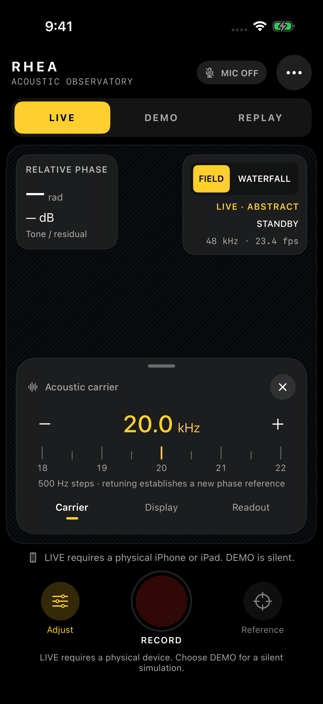
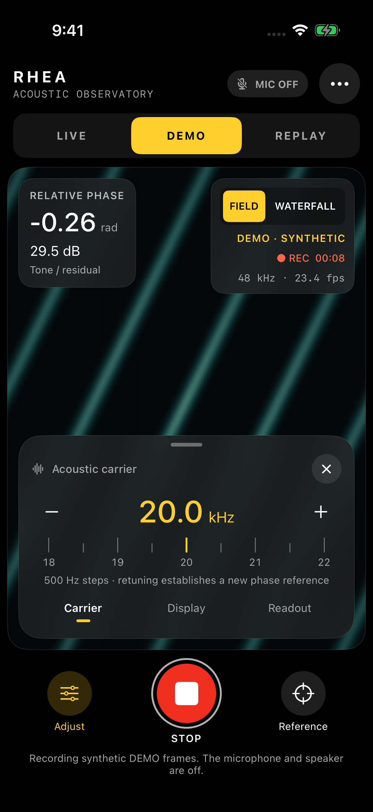
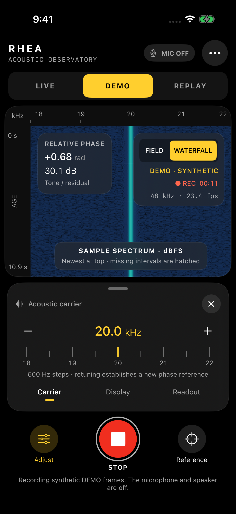

# Observatory validation

This file concerns the Observatory feature branch, not the earlier 18-test
baseline. It records executed checks and identifies the source they tested.

## Verified native result

**All configured checks passed** in
[GitHub Actions run 42413050294](https://github.com/timelabs-npo/Rhea-RF-Spanner/actions/runs/42413050294),
testing source commit
[`6c706d6ab1c374e8bb2d5b1214d6bb13418bf6ee`](https://github.com/timelabs-npo/Rhea-RF-Spanner/commit/6c706d6ab1c374e8bb2d5b1214d6bb13418bf6ee).
The run used Xcode 26.3, Apple Swift 6.2.4, and iOS SDK 26.2 with an iOS 18.0
deployment target. Run timestamps are recorded in UTC in the linked metadata.

| Check | Executed result | Evidence |
| --- | --- | --- |
| Release Swift core | Build succeeded | [Build log](validation/observatory/macos/swift-build-release.log) |
| macOS core tests | 41 tests, 0 failures | [Test log](validation/observatory/macos/swift-test.log) |
| Generic iOS Simulator Debug app | `BUILD SUCCEEDED` | [Simulator build log](validation/observatory/macos/xcode-simulator.log) |
| Unsigned iOS device Release app | `BUILD SUCCEEDED` | [Device build log](validation/observatory/macos/xcode-device-unsigned.log) |
| iPhone 17 Pro Simulator launch | Idle, DEMO Field, DEMO Waterfall captured | [Capture log](validation/observatory/macos/simulator-capture.log) |
| Simulator-hosted session integration | 2 tests, 0 failures; `TEST SUCCEEDED` | [Session test log](validation/observatory/macos/xcode-session-tests.log) |

The hosted tests exercise retuning from 20 to 20.5 kHz into a new epoch,
transition to Replay while the retiring worker drains, retention of the original
simulated source, display-parameter isolation from acquisition, background stop,
and no automatic restart when the app returns to the foreground. They use silent
DEMO and do not establish microphone or speaker performance.

The complete Actions artifact, including the XCTest result bundle, is linked
from the run. The compiler/test logs and original PNG captures are retained in
this repository so they do not depend on the artifact's seven-day retention.
See [run-summary.json](validation/observatory/macos/run-summary.json).

## Native visual evidence

These are original `simctl` PNG captures of the compiled application, without
generative reconstruction or screenshot compositing. The Waterfall uses the
generated sample spectrum; the Field view is explicitly synthetic in DEMO.

| Idle | DEMO Field | DEMO Waterfall |
| --- | --- | --- |
|  |  |  |

The screenshots were reviewed for source labels, microphone state, legible
carrier controls, numerical readouts, and frequency/time axes. The Waterfall
selector's wrapping was corrected before the successful capture. This is visual
inspection on one Simulator size, not a claim that the full device/accessibility
matrix has been exercised.

## Executed portable checks

Swift 6.0.3 on Linux, optimized configuration: **41 tests passed**, including
codec overflow handling and the last representable UInt64 sample boundary.
[Full log](validation/observatory/linux/swift-test-release.log).

The first macOS attempt at `66dfb3794c9e6a37e5918842b2365dca4bcb4422` stopped
during test compilation because a fixture named `record` collided with Apple
XCTestCase.record. The fixture was renamed. This is retained as a failed
attempt, not an application build pass.

## Native check history

The first complete native application build at
`a878d1b51ee257aeeb8849f4991a01e26fe9fad9` passed all 41 macOS core tests,
the iOS Simulator Debug build, and the unsigned iOS device Release build.
The app launched in an iPhone 17 Pro Simulator and produced three screenshots.
[Run 42411819132](https://github.com/timelabs-npo/Rhea-RF-Spanner/actions/runs/42411819132)
then failed while linking the app for its hosted tests: the package product was
rebuilt for arm64 while the app still attempted an x86_64 link. No hosted test
was executed in that attempt.

The correction sets Debug `ONLY_ACTIVE_ARCH=YES` at project level and chooses
the host architecture for the specific Simulator test destination. The generic
Simulator build explicitly retains `ONLY_ACTIVE_ARCH=NO`, preserving its
multi-architecture build coverage. The successful run above verifies the fix at
`6c706d6ab1c374e8bb2d5b1214d6bb13418bf6ee`.

The 43 build-input Git blob hashes match that published commit byte for byte;
see [build-input-match.json](validation/observatory/build-input-match.json) and
[source-sha256.json](validation/observatory/source-sha256.json).
The later evidence/documentation commit changes no build inputs; it does not
claim an additional compiler execution for that documentation commit.

## Still requiring a physical iPhone and distribution credentials

- Speaker/microphone response across the selected 18–22 kHz grid, actual route
  formats, tone audibility, interruption handling, and phase stability.
- Frame pacing, thermal behavior, and accessibility on supported devices.
- Registered Apple team/bundle, signed archive, TestFlight upload/review, and
  completed support/privacy contact metadata.

An unsigned build or a simulator screenshot does not establish these outcomes.
